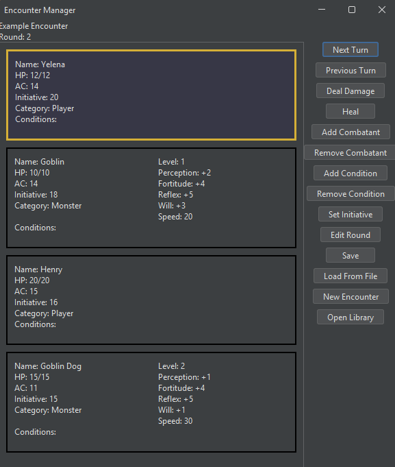
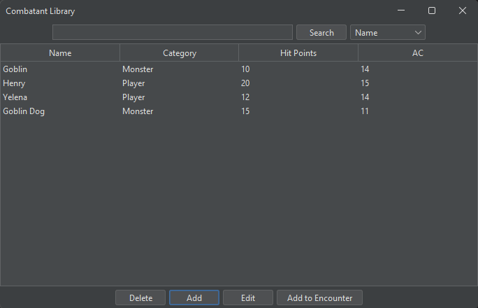
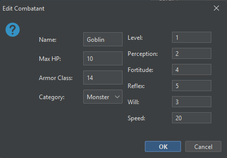

# RPG Encounter Tracker

A Java Swing application for building and managing tabletop RPG combat encounters. Track initiative, turns, rounds, hit points, armor class, and conditions, or manage reusable combatants in a local SQLite library.

## Features

### Encounter Management
- Create and manage combat encounters
- Track initiative order, turns, and rounds
- Add and remove combatants
- Track hit points, armor class, and conditions
- Apply damage and healing
- Highlight the combatant whose turn is active
- Save and load encounters

### Combatant Library
- Store reusable combatants in a local SQLite database
- Create, edit, and delete library entries
- Search combatants by name, category, and creature type
- Organize combatants by category, such as Monster, NPC, and Player
- Store optional Pathfinder 2e stat blocks
- Add library combatants to an encounter

## Screenshots

<!-- Replace the image paths below with screenshots saved in the images/ folder. -->

### Encounter Tracker



### Combatant Library



### Combatant Editor



## Requirements

- Git
- A JDK compatible with the Java release configured in `pom.xml`
- Maven (optional; the repository includes Maven Wrapper scripts)

> The current `pom.xml` sets `maven.compiler.release` to `27`. If your installed JDK does not support that release, change this property to a release supported by your JDK before building.

## Installation

### 1. Clone the repository

```bash
git clone https://github.com/RagnarWinterhart/java-RPG-encounter-tracker.git
cd java-RPG-encounter-tracker
```

Alternatively, download the repository as a ZIP file and extract it.

### 2. Open the project

Open the project folder in an IDE with Maven support, such as IntelliJ IDEA. Allow the IDE to import the Maven project and resolve its dependencies.

The project uses Maven to manage dependencies, including SQLite JDBC and FlatLaf.

### 3. Build the project

On Windows, run:

```powershell
.\mvnw.cmd clean package
```

On macOS or Linux, run:

```bash
./mvnw clean package
```

If you have Maven installed separately, you can use `mvn clean package` instead.

### 4. Run the application

Run the `Main` class from your IDE.

The application uses a local SQLite database for the combatant library. The database file is named `encounter_tracker.db`; keep it in a safe location if you want to preserve your library data.

## Saving Encounters

Use the encounter save and load controls in the application to save an encounter to a file and load it again later.

## Technologies

- Java
- Java Swing
- Maven
- SQLite and SQLite JDBC
- FlatLaf
- JUnit

## Project Structure

```text
.
├── src/             # Application source code and resources
├── test/            # Tests
├── documentation/  # Project documentation
├── images/          # README screenshots and project images
├── pom.xml          # Maven project configuration
├── mvnw             # Maven Wrapper (macOS/Linux)
└── mvnw.cmd         # Maven Wrapper (Windows)
```

## Documentation

Project documentation and diagrams are available in the `documentation/` directory.

## Author

Rowan Lynn
